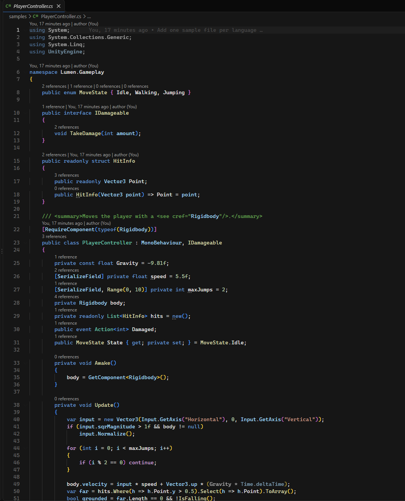
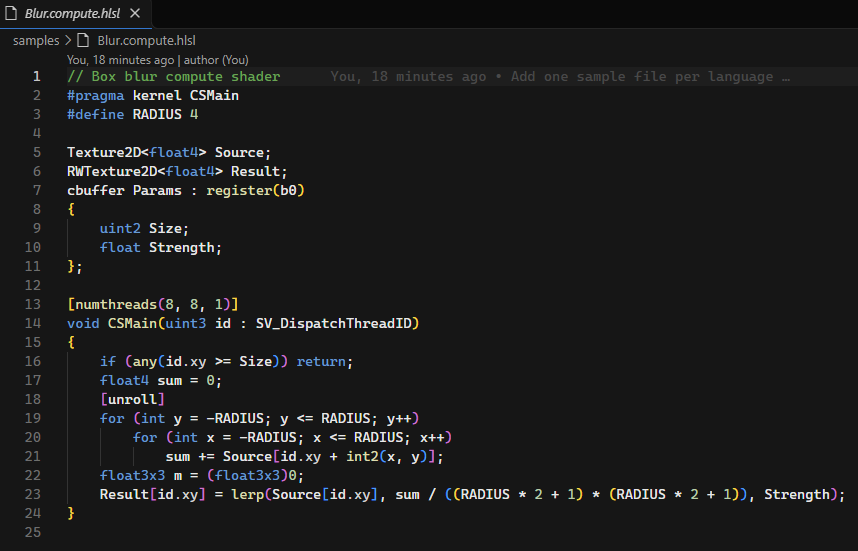
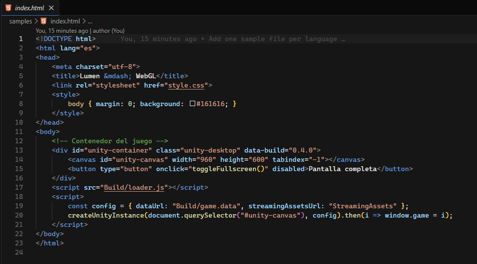
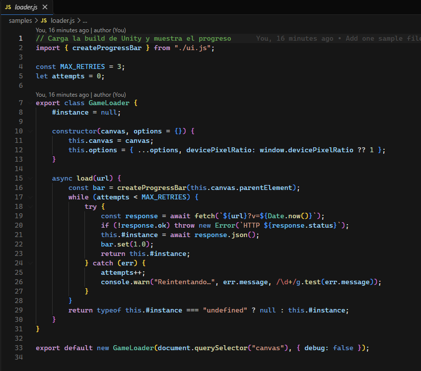
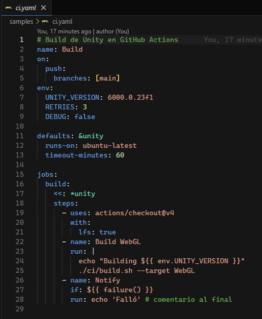
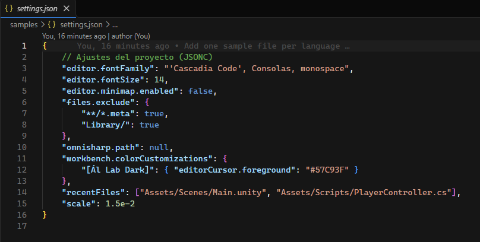
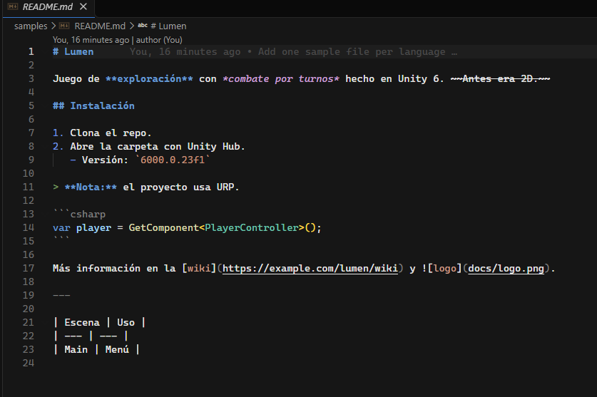
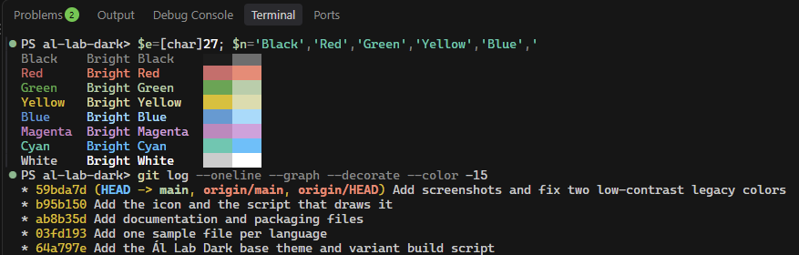
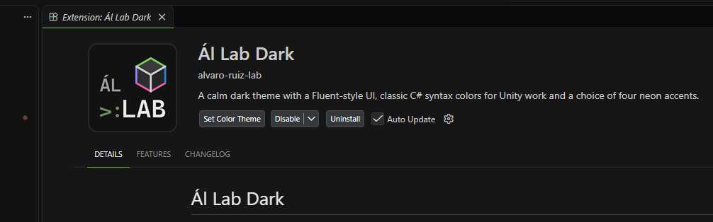
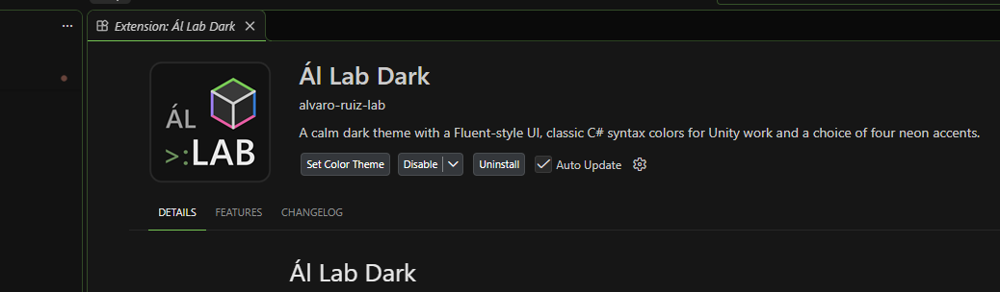

# Ál Lab Dark

Un tema oscuro y tranquilo para Visual Studio Code, con una interfaz de estilo Fluent, los colores de C# de Visual Studio y cuatro acentos neón a elegir. Está pensado para sesiones largas de C# y Unity, y cubre también el resto de lenguajes que aparecen por el camino.

[Read in English](README.md)



## Características

- **Cuida la vista.** Fondos casi negros, texto con buen contraste y un acento que solo aparece en líneas finas, badges y marcos de foco. Las superficies grandes, la barra de título y la barra de estado siguen oscuras.
- **C# como en Visual Studio.** Palabras clave, tipos, métodos, variables locales y campos mantienen los colores de Visual Studio, también los colores semánticos de la extensión de C#: structs, interfaces y enums en amarillo; clases en verde azulado; campos y propiedades en blanco.
- **Listo para Unity.** También se colorean los shaders (ShaderLab y HLSL), USS, UXML, Razor y los `.csproj`.
- **El resto de lenguajes.** Los lenguajes web, de scripting, de datos y de sistemas [de la lista de abajo](#lenguajes-soportados) usan las reglas Dark+ de VS Code, adaptadas a la misma paleta.
- **Interfaz completa.** Unos 380 colores de interfaz: Git, diff, diagnósticos, terminal, depurador, notebooks, chat y más. Nada recurre a un color por defecto que desentone.
- **Diagnósticos legibles.** Errores, avisos y cambios de Git usan un rojo, un amarillo y un verde bien distintos.

## Lenguajes soportados

C# lleva los colores de Visual Studio; el resto de lenguajes parte de las reglas Dark+ de VS Code, adaptadas a la misma paleta.

| Grupo | Lenguajes |
| --- | --- |
| .NET | C# (con colores semánticos), Razor y Blazor (`.razor`, `.cshtml`), `.csproj` (XML) |
| Unity | ShaderLab (`.shader`), HLSL (`.hlsl`, compute shaders), USS, UXML, plugins de WebGL (`.jslib`, `.jspre`, como JavaScript) |
| Web | HTML, CSS, JavaScript, TypeScript, JSX y TSX, PHP |
| Sistemas y backend | C y C++, Rust, Go, Java, Python, SQL |
| Scripting | PowerShell, Bash |
| Datos y configuración | JSON y JSON con comentarios, YAML, `.editorconfig`, `.gitignore` |
| Texto y Git | Markdown, diff, mensajes de commit de Git |

## Capturas

| | |
| --- | --- |
|  |  |
| HLSL | HTML |
|  |  |
| JavaScript | YAML |
|  |  |
| JSON | Markdown |



## Variantes

El tema trae ocho variantes: cuatro colores de acento, cada uno en dos niveles.

| Acento | Color | Sutil | Marcado (*Bold*) |
| --- | --- | --- | --- |
| Azul | `#0078D4` | Ál Lab Dark Blue | Ál Lab Dark Blue Bold |
| Magenta | `#FF4FA3` | Ál Lab Dark Magenta | Ál Lab Dark Magenta Bold |
| Violeta | `#A07BFF` | Ál Lab Dark Violet | Ál Lab Dark Violet Bold |
| Fósforo | `#57C93F` | Ál Lab Dark Phosphor | Ál Lab Dark Phosphor Bold |

- **Sutil** muestra el acento solo donde trabajas: la línea bajo la pestaña activa, el icono activo de la barra de actividad, los marcos de foco, los badges, la barra de progreso y la selección teñida de las listas.
- **Marcado** (las variantes *Bold*) añade bordes tenues del acento alrededor y entre los paneles y bajo las pestañas, una línea fina bajo la barra de título y sobre la de estado, y el cursor y el número de la línea actual en el color del acento.

| Ál Lab Dark Phosphor | Ál Lab Dark Phosphor Bold |
| --- | --- |
|  |  |

Se cambia de una a otra con **Preferences: Color Theme** (`Ctrl+K Ctrl+T`). El tema se previsualiza mientras recorres la lista.

## Instalación

1. Abre la vista de extensiones (`Ctrl+Shift+X`).
2. Busca **Ál Lab Dark** y pulsa **Install**.
3. Elige una variante en **Preferences: Color Theme** (`Ctrl+K Ctrl+T`).

Desde la línea de comandos:

```sh
code --install-extension alvaro-ruiz-lab.al-lab-dark
```

## Ajustes recomendados

Un tema de color solo define colores. Estos ajustes completan el aspecto:

```jsonc
{
    "workbench.colorTheme": "Ál Lab Dark Blue",
    "editor.fontFamily": "'Cascadia Code', Consolas, 'Courier New', monospace",
    "editor.semanticHighlighting.enabled": true
}
```

- [Cascadia Code](https://github.com/microsoft/cascadia-code) es la fuente de Visual Studio y de Windows Terminal. Si no está instalada, VS Code usa Consolas.
- El resaltado semántico viene activado por defecto. Es lo que permite a la extensión de C# distinguir clases de structs y variables locales de campos.
- Para C#, instala la [extensión de C#](https://marketplace.visualstudio.com/items?itemName=ms-dotnettools.csharp) o C# Dev Kit. Para Unity, añade [Unity](https://marketplace.visualstudio.com/items?itemName=visualstudiotoolsforunity.vstuc), que además trae las gramáticas de shaders, USS y UXML.
- Los iconos de archivos y carpetas vienen de un tema de iconos, no del tema de color. Sirve cualquiera.

## Paleta

### Interfaz

| Uso | Colores |
| --- | --- |
| Fondos | `#0A0A0A` barra de pestañas · `#121212` barra de título, barras laterales y barra de estado · `#161616` editor · `#1C1C1C` widgets · `#242424` pestaña activa · `#2A2A2A` campos de texto |
| Bordes | `#262626` · `#0E0E0E` |
| Texto | `#E8E8E8` · `#CCCCCC` · `#9D9D9D` |
| Estado | error `#F48771` · aviso `#DDBF00` · info `#3794FF` |
| Git | añadido `#81B88B` · modificado `#E2C08D` · borrado `#C74E39` |

El editor de diff y las marcas de cambios del margen mantienen los colores por defecto de VS Code, que son los que mejor se leen.

### C#

| Elemento | Color | Ejemplos |
| --- | --- | --- |
| Palabras clave | `#569CD6` | `public`, `void`, `class`, `new`, `var` |
| Palabras de control | `#D8A0DF` | `if`, `for`, `return`, `switch`, `yield` |
| Clases, delegados, parámetros de tipo | `#4EC9B0` | `MonoBehaviour`, `Action<int>`, `T` |
| Structs, interfaces, enums | `#DCDCAA` | `Vector3`, `IDisposable`, `MoveState` |
| Métodos | `#DCDCAA` | `Update()`, `GetComponent<T>()` |
| Parámetros y variables locales | `#9CDCFE` | `index`, `input` |
| Campos, propiedades, eventos, constantes | `#E8E8E8` | `transform`, `_speed`, `Damaged` |
| Namespaces y miembros de enum | `#E8E8E8` | `UnityEngine`, `MoveState.Idle` |
| Strings | `#D69D85` | `"Horizontal"` |
| Escapes | `#D7BA7D` | `\n`, `\t` |
| Comentarios | `#57A64A` | `// TODO` |
| Números | `#B5CEA8` | `5.5f`, `0x1F` |
| `true`, `false`, `null` | `#569CD6` | |
| Operadores | `#D4D4D4` | `=`, `=>`, `&&`, `?.` |
| Código excluido | `#808080` | código dentro de un `#if` falso |

### Otros lenguajes

El resto de lenguajes usa los colores Dark+ de VS Code, con los strings, comentarios y palabras de control de la paleta de C#. Algunos añadidos:

| Lenguaje | Elemento | Color |
| --- | --- | --- |
| ShaderLab, HLSL, C/C++ | Directivas del preprocesador (`#pragma`, `#include`) | `#569CD6` |
| C/C++ | Nombres de macro | `#BEB7FF` |
| YAML | Anclas y alias (`&base`, `*base`) | `#4EC9B0` |
| Python | `self`, `cls` | `#569CD6` |
| Bash | Opciones de línea de comandos (`-euo`) | `#D7BA7D` |
| Diff, commits de Git | Añadido, borrado, modificado | `#81B88B`, `#F14C4C`, `#E2C08D` |
| Razor, Blazor | Componentes (`<ScoreBoard />`) | `#4EC9B0` |

## Limitaciones conocidas

- **Hasta que la extensión de C# carga el proyecto**, solo colorea la gramática. Durante esos segundos todos los tipos salen en verde azulado, y una variable local y un campo se ven igual cuando les sigue un punto (`input.x`, `body.x`). En cuanto carga el proyecto, mandan los colores semánticos.
- **La extensión de C# no distingue tus tipos de los de Unity o de una librería.** Todos los structs comparten color, y lo mismo pasa con las clases.
- **En los shaders, `float4` y `half3` tienen el color de `float`.** La gramática les da el mismo scope.
- **Los parámetros de PowerShell (`-Recurse`) no tienen color propio.** La gramática no los marca.

## Contribuir

Los errores y sugerencias son bienvenidos en las [incidencias](https://github.com/alvaro-ruiz-lab/al-lab-dark/issues) del repositorio. Para cambiar el tema o probarlo desde el código, mira [CONTRIBUTING.md](CONTRIBUTING.md).

## Historial

El tema empezó con los colores de Visual Studio para trabajar con C# y Unity, y fue creciendo desde ahí. Cada versión está en el [CHANGELOG.md](CHANGELOG.md). De la más reciente a la más antigua:

- **2.0.0**: primera versión pública. `package.json` público, con publisher `alvaro-ruiz-lab`, licencia MIT y enlaces al repositorio; el ID de la extensión es `alvaro-ruiz-lab.al-lab-dark`. Las variantes se llaman por su acento para que se ordenen juntas (Ál Lab Dark Blue, Magenta, Violet y Phosphor, cada una con su nivel *Bold*). Icono nuevo: un cubo con los cuatro acentos y LAB como protagonista. Compatible con la interfaz moderna de las versiones recientes de VS Code: sus paneles flotantes llevan los bordes del tema (en el color del acento en las variantes *Bold*), y la pestaña activa y el icono activo de la barra de actividad, un fondo teñido con el acento.
- **Sintaxis para todos los lenguajes** (sin cambio de versión): la base son las reglas de Dark+ con los strings, comentarios y palabras de control de Visual Studio, y encima van reglas para shaders de Unity y HLSL, C/C++, YAML, Python, Bash, diff, commits de Git y Razor. Rust, Go, Java, PHP y TSX pasan de salir casi todo en blanco a tener color. En C# cambian, a propósito: números (`#B5CEA8`), `true`/`false`/`null` (azul), operadores (de azul a `#D4D4D4`) y tipos sin cargar el proyecto (de blanco a verde azulado); se añaden los semánticos de namespaces, eventos, constantes, miembros de enum, delegados, parámetros de tipo, métodos de extensión, escapes, código excluido y `[Obsolete]` (tachado). Arreglado: las llamadas a funciones pintaban de amarillo los argumentos y paréntesis en Python, JS y Java, y en TypeScript las interfaces y enums salían amarillos por reglas de C#.
- **Interfaz completa y acentos** (sin cambio de versión; la 2.0.0 llegará al publicar): 8 variantes con 4 acentos y 2 niveles, generadas desde un único tema base. La interfaz pasa de 115 a 378 colores: Git, errores y avisos, terminal (16 colores ANSI), sugerencias, hover, paleta de comandos, peek, notificaciones, corchetes por pares (dorado, morado y azul), minimapa, depurador, ajustes, chat y notebooks. Antes, todo eso salía con los colores de Dark+. Además: la pestaña activa solo lleva línea abajo; la selección de las listas y los menús se tiñe del acento; los avisos usan un amarillo más distinto del rojo (`#DDBF00`); la barra de estado ya no se pone morada sin carpeta ni naranja pleno al depurar; los números de línea suben de `#565656` a `#6E6E6E` para leerse mejor. El diff de Git sigue con los colores de VS Code, que se leen mejor. Los colores del código no cambian.
- **1.3.0**: pestañas con más contraste. La barra de pestañas es más oscura (`#0A0A0A`), las inactivas quedan en un punto intermedio (`#141414`) y la activa es más clara (`#242424`), con borde azul arriba y abajo (`tab.activeBorderTop` y `tab.activeBorder`) a modo de contorno, y separadores visibles entre pestañas. Si el grupo de editores no tiene el foco, la pestaña activa se ve en gris en lugar de azul. Antes la pestaña activa tenía el mismo color que el fondo del editor y casi no se distinguía de las demás. Solo cambia el aspecto de las pestañas; el resto del tema queda igual.
- **1.2.0**: colores para Markdown (`.md`), equivalentes a Dark+. Antes el Markdown no tenía resaltado de títulos, negrita, cursiva, tachado, citas, listas, código en línea, bloques de código ni enlaces: todo salía en el blanco por defecto del editor.
- **1.1.0**: colores para HTML, CSS y JavaScript/TypeScript, equivalentes a Dark+. Antes solo existían reglas para C#, así que HTML y CSS salían casi sin color y en JS las variables y propiedades se veían blancas. C# no cambia.
- **1.0.0**: versión inicial. Añadidos después: structs en amarillo y palabras de control en morado, como en Visual Studio.

## Licencia y créditos

Publicado con la [licencia MIT](LICENSE).

Las reglas de sintaxis de los lenguajes que no son C# parten del tema Dark+ de [Visual Studio Code](https://github.com/microsoft/vscode) (licencia MIT, © Microsoft Corporation); su aviso de licencia está incluido en [LICENSE](LICENSE). Los colores de C# siguen los que usa Visual Studio.

Visual Studio, Visual Studio Code y VS Code son marcas de Microsoft Corporation, y Unity es una marca de Unity Technologies. Ál Lab Dark es un proyecto independiente, sin relación con ninguna de las dos empresas ni respaldo de ellas.

<sub>Este tema se ha desarrollado con ayuda de herramientas de programación con IA. La extensión en sí es un tema de color sin más: no incluye funciones de IA ni ejecuta código.</sub>
