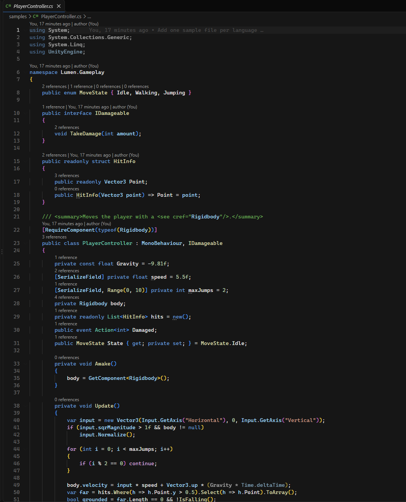
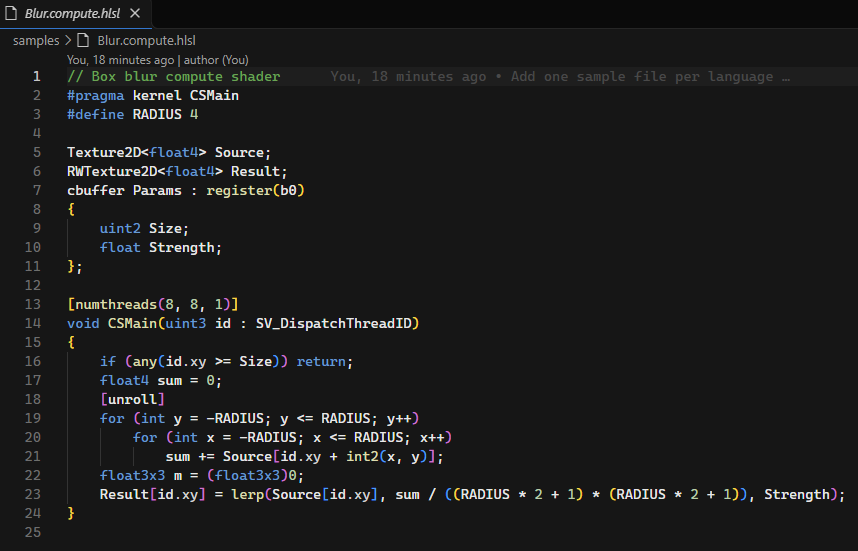
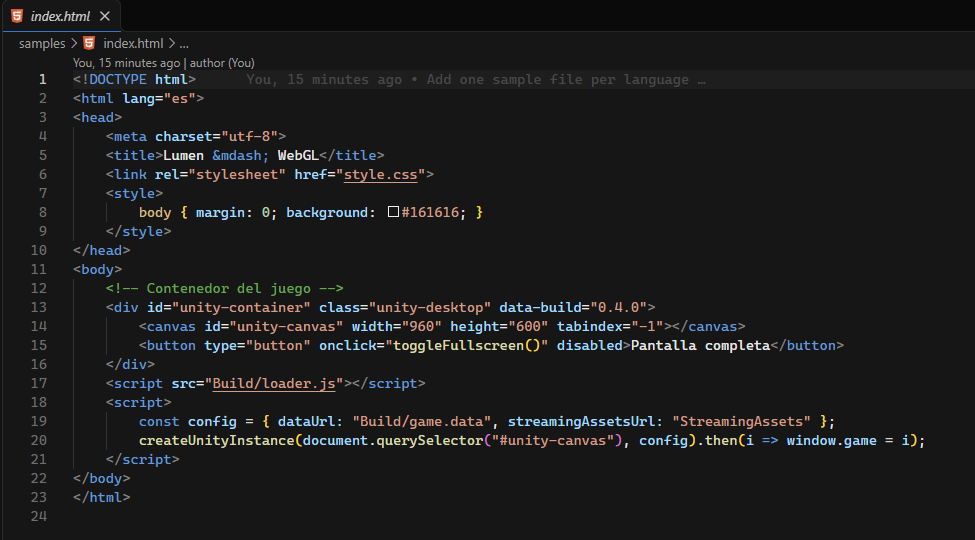
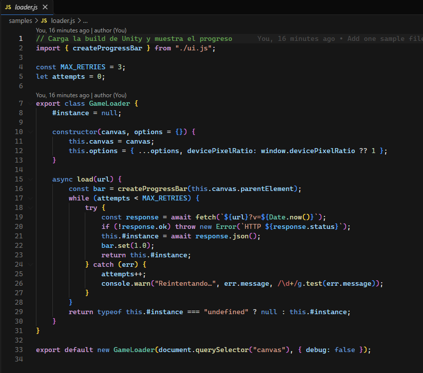
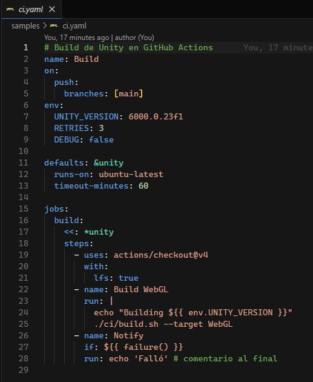
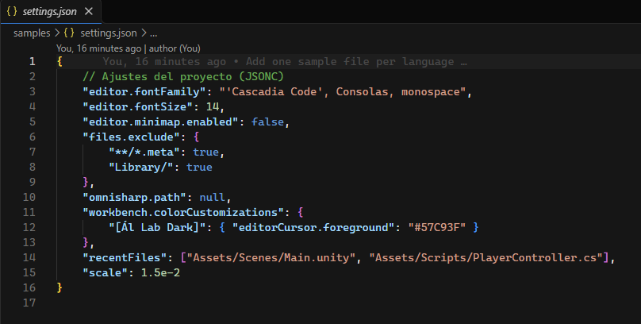
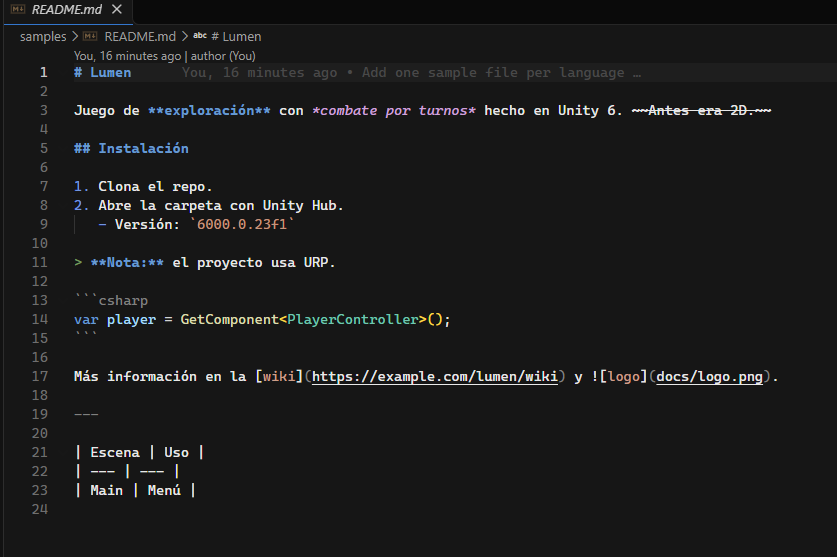
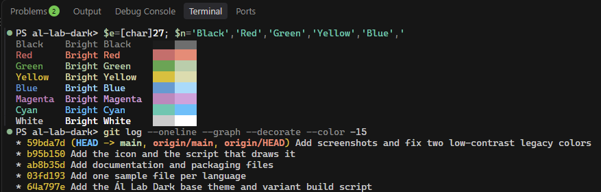
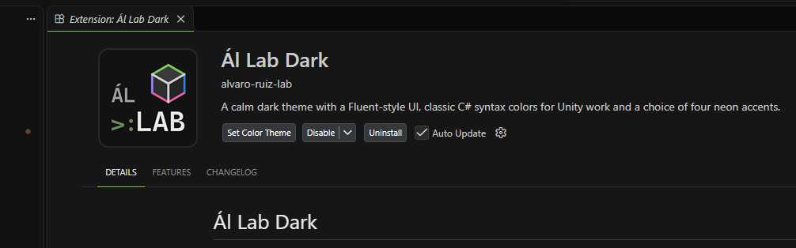
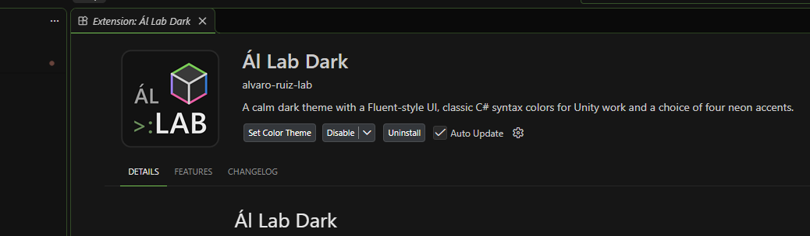

# Ál Lab Dark

A calm dark theme for Visual Studio Code with a Fluent-style interface, the C# colors of Visual Studio and a choice of four neon accents. It was made for long sessions of C# and Unity work, and it covers the rest of the languages you meet along the way.

[Leer en español](README.es.md)



## Features

- **Easy on the eyes.** Near-black backgrounds, high-contrast text and an accent that only appears in thin lines, badges and focus rings. Large surfaces, the title bar and the status bar stay dark.
- **C# as in Visual Studio.** Keywords, types, methods, locals and fields keep the colors you know from Visual Studio, including the semantic colors of the C# extension: structs, interfaces and enums in yellow, classes in teal, fields and properties in white.
- **Unity-ready.** Shaders (ShaderLab and HLSL), USS, UXML, Razor and `.csproj` files are colored too.
- **Every other language.** The web, scripting, data and systems languages [listed below](#supported-languages) use the Dark+ rules of VS Code, adapted to the same palette.
- **A complete interface.** Around 380 interface colors: Git, diff, diagnostics, terminal, debugger, notebooks, chat and more. Nothing falls back to a mismatched default.
- **Readable diagnostics.** Errors, warnings and Git changes use clearly distinct red, yellow and green.

## Supported languages

C# has the colors of Visual Studio; every other language starts from the Dark+ rules of VS Code, adapted to the same palette.

| Group | Languages |
| --- | --- |
| .NET | C# (with semantic colors), Razor and Blazor (`.razor`, `.cshtml`), `.csproj` (XML) |
| Unity | ShaderLab (`.shader`), HLSL (`.hlsl`, compute shaders), USS, UXML, WebGL plugins (`.jslib`, `.jspre`, as JavaScript) |
| Web | HTML, CSS, JavaScript, TypeScript, JSX and TSX, PHP |
| Systems and backend | C and C++, Rust, Go, Java, Python, SQL |
| Scripting | PowerShell, Bash |
| Data and configuration | JSON and JSON with comments, YAML, `.editorconfig`, `.gitignore` |
| Text and Git | Markdown, diff, Git commit messages |

## Screenshots

| | |
| --- | --- |
|  |  |
| HLSL | HTML |
|  |  |
| JavaScript | YAML |
|  |  |
| JSON | Markdown |



## Variants

The theme ships eight variants: four accent colors, each at two levels.

| Accent | Color | Subtle | Bold |
| --- | --- | --- | --- |
| Blue | `#0078D4` | Ál Lab Dark Blue | Ál Lab Dark Blue Bold |
| Magenta | `#FF4FA3` | Ál Lab Dark Magenta | Ál Lab Dark Magenta Bold |
| Violet | `#A07BFF` | Ál Lab Dark Violet | Ál Lab Dark Violet Bold |
| Phosphor | `#57C93F` | Ál Lab Dark Phosphor | Ál Lab Dark Phosphor Bold |

- **Subtle** shows the accent only where you are working: the line under the active tab, the active activity bar icon, focus rings, badges, the progress bar and a tinted selection in lists.
- **Bold** also adds faint accent borders around and between the panels and under the tabs, a thin line under the title bar and above the status bar, and an accent cursor and current line number.

| Ál Lab Dark Phosphor | Ál Lab Dark Phosphor Bold |
| --- | --- |
|  |  |

Switch between them with **Preferences: Color Theme** (`Ctrl+K Ctrl+T`). The theme previews as you move through the list.

## Installation

1. Open the Extensions view (`Ctrl+Shift+X`).
2. Search for **Ál Lab Dark** and select **Install**.
3. Pick a variant from **Preferences: Color Theme** (`Ctrl+K Ctrl+T`).

From the command line:

```sh
code --install-extension alvaro-ruiz-lab.al-lab-dark
```

## Recommended settings

A color theme only sets colors. These settings complete the look:

```jsonc
{
    "workbench.colorTheme": "Ál Lab Dark Blue",
    "editor.fontFamily": "'Cascadia Code', Consolas, 'Courier New', monospace",
    "editor.semanticHighlighting.enabled": true
}
```

- [Cascadia Code](https://github.com/microsoft/cascadia-code) is the font of Visual Studio and Windows Terminal. If it is not installed, VS Code falls back to Consolas.
- Semantic highlighting is on by default. It lets the C# extension tell classes from structs and locals from fields.
- For C#, install the [C# extension](https://marketplace.visualstudio.com/items?itemName=ms-dotnettools.csharp) or C# Dev Kit. For Unity, add [Unity](https://marketplace.visualstudio.com/items?itemName=visualstudiotoolsforunity.vstuc), which also brings the shader, USS and UXML grammars.
- File and folder icons come from an icon theme, not from a color theme. Any icon theme works.

## Palette

### Interface

| Role | Colors |
| --- | --- |
| Backgrounds | `#0A0A0A` tab bar · `#121212` title bar, sidebars and status bar · `#161616` editor · `#1C1C1C` widgets · `#242424` active tab · `#2A2A2A` inputs |
| Borders | `#262626` · `#0E0E0E` |
| Text | `#E8E8E8` · `#CCCCCC` · `#9D9D9D` |
| Status | error `#F48771` · warning `#DDBF00` · info `#3794FF` |
| Git | added `#81B88B` · modified `#E2C08D` · deleted `#C74E39` |

The diff editor and the change markers in the gutter keep the VS Code default colors, which read best.

### C#

| Element | Color | Examples |
| --- | --- | --- |
| Keywords | `#569CD6` | `public`, `void`, `class`, `new`, `var` |
| Control keywords | `#D8A0DF` | `if`, `for`, `return`, `switch`, `yield` |
| Classes, delegates, type parameters | `#4EC9B0` | `MonoBehaviour`, `Action<int>`, `T` |
| Structs, interfaces, enums | `#DCDCAA` | `Vector3`, `IDisposable`, `MoveState` |
| Methods | `#DCDCAA` | `Update()`, `GetComponent<T>()` |
| Parameters and locals | `#9CDCFE` | `index`, `input` |
| Fields, properties, events, constants | `#E8E8E8` | `transform`, `_speed`, `Damaged` |
| Namespaces and enum members | `#E8E8E8` | `UnityEngine`, `MoveState.Idle` |
| Strings | `#D69D85` | `"Horizontal"` |
| Escapes | `#D7BA7D` | `\n`, `\t` |
| Comments | `#57A64A` | `// TODO` |
| Numbers | `#B5CEA8` | `5.5f`, `0x1F` |
| `true`, `false`, `null` | `#569CD6` | |
| Operators | `#D4D4D4` | `=`, `=>`, `&&`, `?.` |
| Excluded code | `#808080` | code inside a false `#if` |

### Other languages

Other languages use the Dark+ colors of VS Code, with the strings, comments and control keywords of the C# palette. A few additions:

| Language | Element | Color |
| --- | --- | --- |
| ShaderLab, HLSL, C/C++ | Preprocessor directives (`#pragma`, `#include`) | `#569CD6` |
| C/C++ | Macro names | `#BEB7FF` |
| YAML | Anchors and aliases (`&base`, `*base`) | `#4EC9B0` |
| Python | `self`, `cls` | `#569CD6` |
| Bash | Command-line options (`-euo`) | `#D7BA7D` |
| Diff, Git commit | Added, deleted, changed | `#81B88B`, `#F14C4C`, `#E2C08D` |
| Razor, Blazor | Components (`<ScoreBoard />`) | `#4EC9B0` |

## Known limitations

- **Before the C# extension loads a project**, only the grammar colors the code. During those seconds every type is teal, and a local and a field look the same when followed by a dot (`input.x`, `body.x`). The semantic colors take over as soon as the project loads.
- **The C# extension does not tell your types from Unity's or a library's.** All structs share a color, and so do all classes.
- **In shaders, `float4` and `half3` share the color of `float`.** The grammar gives them the same scope.
- **PowerShell parameters (`-Recurse`) have no color of their own.** The grammar does not mark them.

## Contributing

Bug reports and suggestions are welcome in the [issue tracker](https://github.com/alvaro-ruiz-lab/al-lab-dark/issues). To change the theme or try it from source, see [CONTRIBUTING.md](CONTRIBUTING.md).

## History

The theme started as the Visual Studio colors for C# and Unity work, and grew from there. Each release is listed in [CHANGELOG.md](CHANGELOG.md). Newest first:

- **2.0.0** (preparing for the Marketplace): first public release. Public `package.json` with publisher `alvaro-ruiz-lab`, MIT license and repository links; the extension ID is `alvaro-ruiz-lab.al-lab-dark`. The variants are named after their accent so they sort together (Ál Lab Dark Blue, Magenta, Violet and Phosphor, each with a *Bold* level). New icon: a cube with the four accents and LAB in the lead. Support for the modern workbench layout of recent VS Code versions, whose floating panels get the theme's borders (in the accent color in the Bold variants) and whose active tab and active activity bar icon get an accent-tinted background.
- **Syntax for every language** (no version change): the base is the Dark+ rules with the strings, comments and control keywords of Visual Studio, plus rules for Unity shaders and HLSL, C/C++, YAML, Python, Bash, diff, Git commits and Razor. Rust, Go, Java, PHP and TSX go from mostly white to fully colored. In C#, on purpose: numbers (`#B5CEA8`), `true`/`false`/`null` (blue), operators (from blue to `#D4D4D4`) and types before the project loads (from white to teal); semantic colors are added for namespaces, events, constants, enum members, delegates, type parameters, extension methods, escapes, excluded code and `[Obsolete]` (strikethrough). Fixed: function calls painted their arguments and parentheses yellow in Python, JS and Java, and TypeScript interfaces and enums were yellow because of C# rules.
- **Complete interface and accents** (no version change; 2.0.0 comes with the release): 8 variants with 4 accents and 2 levels, generated from a single base theme. The interface goes from 115 to 378 colors: Git, errors and warnings, terminal (16 ANSI colors), suggestions, hover, command palette, peek, notifications, bracket pairs (gold, purple and blue), minimap, debugger, settings, chat and notebooks. Before, all of that used the Dark+ colors. Also: the active tab only has a line at the bottom; list and menu selections are tinted with the accent; warnings use a yellow that is easier to tell from red (`#DDBF00`); the status bar no longer turns purple without a folder or fully orange while debugging; line numbers go from `#565656` to `#6E6E6E` to read better. The Git diff keeps the VS Code colors, which read better. Code colors do not change.
- **1.3.0**: tabs with more contrast. The tab bar is darker (`#0A0A0A`), inactive tabs sit in between (`#141414`) and the active tab is lighter (`#242424`), with a blue border at the top and bottom (`tab.activeBorderTop` and `tab.activeBorder`) as an outline, and visible separators between tabs. When the editor group does not have focus, the active tab is gray instead of blue. Before, the active tab had the same color as the editor background and was hard to tell apart. Only the tabs change; the rest of the theme stays the same.
- **1.2.0**: colors for Markdown (`.md`), equivalent to Dark+. Before, Markdown had no highlighting for headings, bold, italic, strikethrough, quotes, lists, inline code, code blocks or links: everything was the default editor white.
- **1.1.0**: colors for HTML, CSS and JavaScript/TypeScript, equivalent to Dark+. Before, there were only rules for C#, so HTML and CSS had almost no color and JS variables and properties were white. C# does not change.
- **1.0.0**: first version. Added later: structs in yellow and control keywords in purple, as in Visual Studio.

## License and credits

Released under the [MIT License](LICENSE).

The syntax rules for languages other than C# build on the Dark+ theme of [Visual Studio Code](https://github.com/microsoft/vscode) (MIT License, © Microsoft Corporation); its notice is included in [LICENSE](LICENSE). The C# colors follow the ones Visual Studio uses.

Visual Studio, Visual Studio Code and VS Code are trademarks of Microsoft Corporation, and Unity is a trademark of Unity Technologies. Ál Lab Dark is an independent project, not affiliated with or endorsed by either company.

<sub>This theme was developed with the help of AI coding tools. The extension itself is a plain color theme: it contains no AI features and runs no code.</sub>
